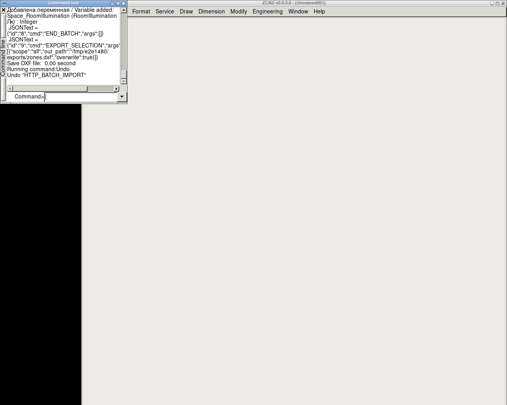

# Сквозная проверка #1480 на собранном ZCAD (Linux, Xvfb)

Ручной сценарий: настоящий ZCAD (`make zcadelectrotech`), настоящий HTTP-сервер,
команды `SPACE_ADD_ROOM` / `SPACE_ADD_POLY`, пакетный режим, выгрузка
`EXPORT_SELECTION` и отмена (Undo). Дополняет модульные проверки
`experiments/issue1480/test_space_room.pas`, которые выполняются в CI. В CI не
включён: нужна полная сборка ZCAD с LCL/GTK2 и X-сервер.

## Файлы

| Файл | Назначение |
|------|------------|
| `run_e2e.sh` | Поднимает Xvfb + openbox, запускает ZCAD (`DWGNew`, `HTTPStart`), фаза `draw`, Undo через командную строку, фаза `undo`, затем `verify_dxf.py` |
| `e2e_check.mjs` | HTTP-проверки фазы `draw` (зоны, ошибки, пакет, выгрузка) или `undo` (пакет отменён одним шагом) |
| `verify_dxf.py` | Читает `zones.dxf` через `ezdxf`: слой, цвет, замкнутость, вершины, `INCLUDINGVOLUMEEXTENDER`, переменные |
| `probe.sh`, `probe.mjs` | Диагностика: произвольная последовательность команд из JSON-файла (шаг `["@UNDO"]` — Undo в командной строке) |
| `steps_export_undo.json` | Шаги, воспроизводившие access violation при Undo после `EXPORT_SELECTION` |
| `stress.mjs` | Параллельные HTTP-запросы; воспроизводил падение GTK2 при выводе в историю из рабочего потока |

## Подготовка

Как в `experiments/issue1478/e2e/README.md`:

1. Копия репозитория для сборки; в ней применить правки для Linux
   (в `master` эти места рассчитаны только на Windows) и собрать из корня:

   ```sh
   git apply experiments/issue1478/e2e/linux-build/velectrnav-linux.patch
   cp experiments/issue1478/e2e/linux-build/comobj.pas cad_source/zcad/velec/managerem/
   make zcadelectrotech LP=/usr/bin PCP=/tmp/pcp
   ```

2. Пакеты времени выполнения (Ubuntu 24.04): `xvfb`, `openbox`, `xdotool`,
   `imagemagick`, `libglu1-mesa`, `libgl1-mesa-dri`; Node.js >= 18;
   для `verify_dxf.py` — Python с `ezdxf`.

## Запуск

```sh
experiments/issue1480/e2e/run_e2e.sh <cad> /tmp/e2e1480 node
```

`<cad>` — каталог `cad` собранной копии (в нём `bin/zcad`). Скрипт задаёт
`ZCAD_EXPORT_DIR=<work>/exports`; журнал ZCAD копируется в
`<work>/zcad.internal.log`, снимки экрана — `<work>/zones.png` и
`<work>/undo.png`, запросы и ответы — `<work>/requests.log`.

Диагностика и нагрузка:

```sh
experiments/issue1480/e2e/probe.sh <cad> experiments/issue1480/e2e/steps_export_undo.json /tmp/probe
STRESS="8 50" experiments/issue1480/e2e/probe.sh <cad> - /tmp/probe
```

## Фазы

| Фаза | Проверки |
|------|----------|
| `draw` | помещение 101 (`name`, `category`) → слой `spaceRoom`, площадь 24 000 000, `batch=false`; `MISSING_NUMBER`; `SELF_INTERSECTING`; этаж `SPACE_ADD_POLY kind=floor` с `space_Floor`; `BEGIN_BATCH`, помещения 102 и 103 (второе — аргументом-строкой JSON), `END_BATCH`; `EXPORT_SELECTION scope=all` → 4 объекта |
| `undo` | после одной команды `Undo` в чертеже 2 объекта: пакет `END_BATCH` отменён одним шагом |

Перед первой командой `e2e_check.mjs` отправляет пробный запрос
`SPACE_ADD_ROOM` без номера (чертёж не меняет), пока он не перестанет
получать `"Command timeout"`: HTTP-сервер отвечает раньше, чем главный поток
закончит запуск. Команда, получившая `"Command timeout"`, отменяется до
выполнения (`uzvhttpipc`), поэтому `ipc()` повторяет её до двух раз; каждая
попытка записывается в `requests.log`, а лишняя зона была бы видна по
`entity_count` и `verify_dxf.py`.

## Результат (ZCAD из ветки)

```
PASS e2e SPACE_ADD_ROOM
PASS e2e undo
spaceRoom color 5 flags 9 vertices 4 ['INCLUDINGVOLUMEEXTENDER'] {'Space_RoomPos': ('String', '101'), 'Space_RoomName': ('String', 'Кабинет'), 'Space_RoomArea': ('String', '0'), 'Space_RoomCategory': ('String', 'Д'), 'Space_RoomIllumination': ('Integer', '0')}
spaceFloor color 4 flags 9 vertices 4 ['INCLUDINGVOLUMEEXTENDER'] {'space_Floor': ('String', '1'), 'space_FloorHeight': ('Double', '0'), 'space_FloorScale': ('Double', '0')}
spaceRoom color 5 flags 9 vertices 4 ['INCLUDINGVOLUMEEXTENDER'] {'Space_RoomPos': ('String', '102'), ...}
spaceRoom color 5 flags 9 vertices 4 ['INCLUDINGVOLUMEEXTENDER'] {'Space_RoomPos': ('String', '103'), ...}
PASS DXF zones
```

Нагрузка (`stress.mjs`): `streams=1 per=150 timeouts=0 max_ms=16 ALIVE true`;
`streams=8 per=50 ... ALIVE true` (отдельные `UND_ERR_SOCKET` — повторное
использование сокета клиентом после закрытия соединения сервером).



## Найдено этим сценарием и исправлено

1. **Падение GTK2 при параллельных запросах** («split_segment reached end of
   line!», ZCAD завершается). `HandleRequest` в `uzvhttpserver.pas` выполняется
   в рабочем потоке `TFPHttpServer` (`Threaded=True`) и писал запрос в историю
   командной строки (`zcUI.TextMessage`) прямо оттуда. Теперь текст передаётся
   в главный поток через `TThread.Queue`. До правки `stress.mjs 8 50`
   завершался `ALIVE false`, после — `ALIVE true`.
2. **Access violation при Undo после `EXPORT_SELECTION`** при наличии зон
   (`GDBObjRoot.DoFormat` → `IsObjectIt`, `uzeroot.pas`). Выгрузка
   форматировала копии объектов относительно текущего чертежа, и расширение
   `extdrIncludingVolume` копии оставляло в `ObjToConnectedArray` корня
   чертежа указатель на копию, которая затем уничтожалась вместе с временным
   чертежом. Первое же форматирование после Undo обращалось к освобождённой
   памяти. Теперь копии форматируются относительно временного чертежа
   (`uzvhttpcmdexportselection.pas`). `steps_export_undo.json` до правки —
   падение, после — `ALIVE true`, в `/tmp/zcadcrashreport.txt` новых записей нет.

## Ограничения

* Один раз за несколько прогонов наблюдалась остановка посреди
  последовательности: запрос не был взят главным потоком за 30 с и получил
  `"Command timeout"`, хотя ZCAD продолжал работу. В 150 последовательных
  запросах и последующих прогонах не повторилась; причина не установлена.
  Вероятно, она общая для HTTP IPC (очередь разбирается только в
  `Application.OnIdle`) и к командам зон не относится. Сценарий повторяет
  такой запрос (см. выше).
* Undo выполняется вводом `Undo` в окно «Command line» через `xdotool`.
